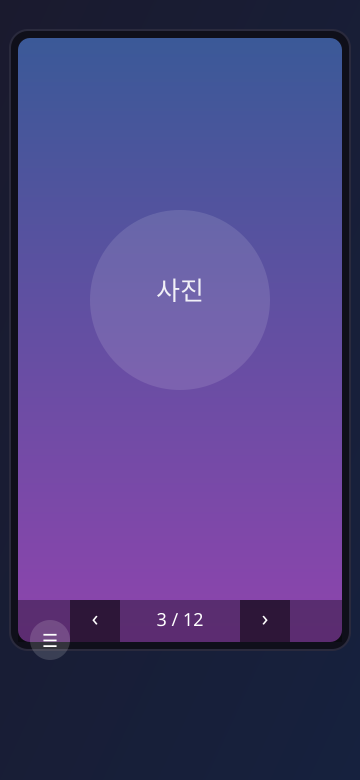
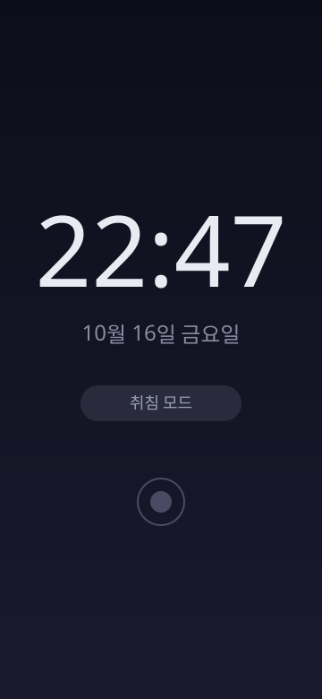
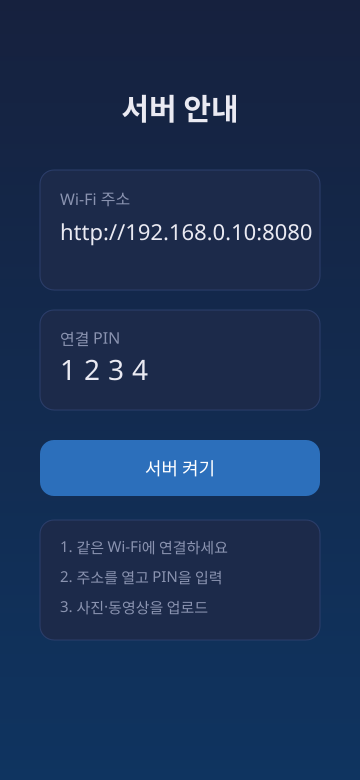
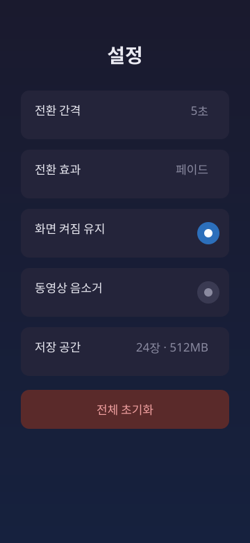

# PhotoEdge (스마트 전자액자)

<p align="center">
  
  
  
  
  
  
</p>

PhotoEdge는 오래된 Android 스마트폰과 태블릿을 디지털 전자액자 겸 탁상 디스플레이로 활용하는 앱입니다.

클라우드 서버 없이 **같은 Wi-Fi에 연결된 PC의 브라우저**에서 사진과 동영상을 전송하면, 액자 기기를 직접 조작하지 않고도 재생 목록에 추가됩니다. 몰입형 슬라이드쇼, 탁상 시계, 취침 스케줄 기능을 하나의 앱에서 제공합니다.

> **현재 상태**: Android 스켈레톤 아키텍처 완성 및 빌드/단위 테스트 검증 완료
> **앱 패키지명**: `com.edgebit.photoedge`

---

## 주요 기능

- **사진 슬라이드쇼**: 전체 화면 자동 전환, 페이드/슬라이드/줌&팬(Ken Burns) 전환 효과
- **동영상 재생**: AndroidX Media3/ExoPlayer 기반, 재생 종료 시 다음 항목 자동 전환
- **PC 로컬 업로드**: 내장 HTTP 서버로 같은 Wi-Fi의 PC 브라우저에서 사진/동영상 전송
- **탁상 시계**: 대형 디지털 시계와 날짜/요일 표시, 침실용 취침 모드
- **취침 스케줄**: 취침 시간 재생 중지 및 알람 연동
- **화면 유지**: 앱이 전면에 있을 때 화면이 꺼지지 않도록 하는 옵션

---

## 스크린샷

앱의 주요 화면을 나타내는 미리보기입니다. (실제 기기 캡처로 교체 예정)

| 슬라이드쇼 | 시계 | 서버 안내 | 설정 |
|---|---|---|---|
|  |  |  |  |

## 로컬 네트워크 구조

PC 브라우저 → 같은 Wi-Fi 공유기 → Android 앱 내부 HTTP 서버 → 앱 내부 저장소 → 슬라이드쇼 재생 목록

- 초기에는 클라우드 서버가 필요하지 않습니다.
- PC와 액자 기기는 같은 로컬 네트워크에 있어야 합니다.
- 공유기의 게스트 네트워크 격리 또는 기기 간 통신 차단이 켜져 있으면 연결되지 않을 수 있습니다.
- 앱 화면에 액자의 IP 주소와 연결 PIN 코드가 표시됩니다.
- 업로드 완료 시 앱 내부 이벤트로 재생 목록이 즉시 갱신됩니다.

---

## 기술 스택

| 영역 | 기술 |
|---|---|
| 앱 개발 | Kotlin 2.0.21 |
| UI | Jetpack Compose (Compose BOM 2024.10.01) |
| 사진·동영상 재생 | AndroidX Media3 / ExoPlayer 1.4.1, Coil 2.7.0 |
| 로컬 사진 저장 | 앱 전용 내부 저장소 |
| 메타데이터 관리 | Room 2.6.1 |
| 설정 저장 | DataStore 1.1.1 |
| PC 업로드 화면 | HTML / CSS / JavaScript (`assets/web/index.html`) |
| 로컬 전송 | 내장 HTTP 서버 (NanoHTTPD 2.3.1) |
| 알람 | AlarmManager |
| 빌드 | Android Gradle Plugin 8.7.2, KSP 2.0.21-1.0.28, Java 17 |

### 지원 플랫폼

- **minSdk**: 26 (Android 8.0 Oreo)
- **targetSdk**: 35 (Android 15)
- **compileSdk**: 35

---

## 프로젝트 구조

```
app/src/main/
├── java/com/edgebit/photoedge/
│   ├── PhotoEdgeApplication.kt      # 전역 의존성 컨테이너 및 내장 서버 라이프사이클
│   ├── MainActivity.kt              # 몰입형 뷰 및 화면 켜짐 제어
│   ├── data/
│   │   ├── model/                   # MediaItem, MediaType, TransitionEffect, FrameSettings
│   │   ├── local/                   # AppDatabase, MediaEntity, MediaDao, PreferencesManager
│   │   ├── storage/                 # MediaStorageManager (내부 저장소)
│   │   ├── repository/              # MediaRepository, SettingsRepository
│   │   └── server/                  # PhotoEdgeServer (내장 HTTP 서버)
│   ├── domain/util/                 # NetworkUtils, AlarmScheduler
│   ├── receiver/                    # AlarmReceiver, BootReceiver
│   └── ui/
│       ├── slideshow/               # 슬라이드쇼 화면 및 ViewModel
│       ├── clock/                   # 시계/취침 화면 및 ViewModel
│       ├── server/                  # 서버 안내 화면 및 ViewModel
│       ├── settings/                # 설정 화면 및 ViewModel
│       ├── components/              # ExoPlayerView 등 공용 컴포넌트
│       ├── navigation/              # Screen, NavGraph
│       └── theme/                   # Color, Type, Theme
├── assets/web/index.html            # PC 브라우저 업로드 UI
└── res/                             # 리소스
```

### 아키텍처

Clean Architecture와 MVVM(Model-View-ViewModel) 패턴을 준수하여 UI, 도메인 로직, 데이터 레이어를 명확히 분리했습니다.

- **UI Layer**: Jetpack Compose 기반 화면 및 ViewModel
- **Domain & Services**: AlarmScheduler, NetworkUtils, AlarmReceiver/BootReceiver
- **Data Layer**: Room DB, 내부 저장소, DataStore, 내장 HTTP 서버
- **External**: PC 브라우저 (같은 Wi-Fi HTTP 전송)

---

## 빌드 및 실행

### 요구 사항

- Android Studio (최신 버전)
- JDK 17 이상
- Android SDK 35

### 빌드

```bash
# 단위 테스트
./gradlew testDebugUnitTest

# Debug APK 빌드
./gradlew assembleDebug
```

최종 빌드 산출물은 `app/build/outputs/apk/debug/app-debug.apk`에 생성됩니다.

### 실행 및 사용 방법

1. 앱을 Android 기기 또는 에뮬레이터에 설치하고 실행합니다.
2. 서버 안내 화면에 표시된 Wi-Fi IP 주소와 PIN 코드를 확인합니다.
3. 같은 Wi-Fi의 PC 브라우저에서 `http://<안드로이드 IP>:8080`에 접속합니다.
4. PIN 코드를 입력하고 사진/동영상을 업로드합니다.
5. 업로드된 미디어가 슬라이드쇼에 즉시 반영됩니다.

---

## 검증 결과

- **단위 테스트** (`testDebugUnitTest`): `BUILD SUCCESSFUL` (25 actionable tasks, 전체 테스트 통과)
- **Debug APK 빌드** (`assembleDebug`): `BUILD SUCCESSFUL` (37 actionable tasks)
- **APK 크기**: 약 21.6 MB

---

## 다음 단계

- 실제 기기 또는 에뮬레이터에서 실행 및 업로드 테스트
- 사진/동영상 전환 성능 튜닝
- 취침 스케줄 세부 시간 피커 UI 보강
- 기기 검색용 NSD(mDNS) 기능 검토
- 광고/유료화 및 Google Play 출시 (개발 계획서 참고)

---

## 관련 문서

- [개발 계획서](smart_photo_frame_android_development_plan.md): 제품 방향, 기능 범위, 기술 설계, 출시 전략
- [구현 보고서](android_skeleton_implementation_report.md): 스켈레톤 구현 내역과 검증 결과

---

## 라이선스

> 라이선스는 아직 지정되지 않았습니다. 배포 전에 결정해 주세요.


