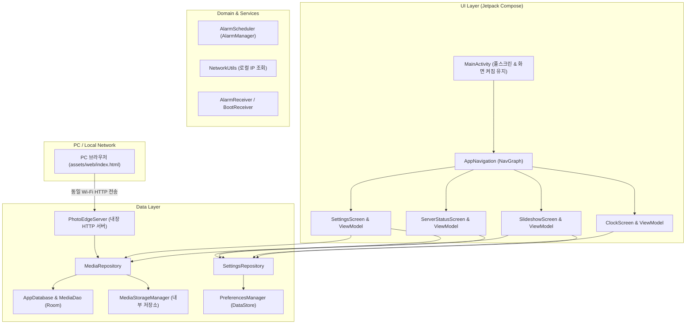

# PhotoEdge (스마트 전자액자) 안드로이드 스켈레톤 구현 보고서

- **작성일**: 2026-10-16
- **기준 계획서**: [smart_photo_frame_android_development_plan.md](smart_photo_frame_android_development_plan.md)
- **앱 패키지명**: `com.edgebit.photoedge`
- **구현 상태**: 안드로이드 스켈레톤 아키텍처 완성 및 빌드/단위 테스트 검증 완료

---

## 1. 개요 및 구현 목표

본 프로젝트는 오래된 안드로이드 스마트폰과 태블릿을 디지털 전자액자 겸 탁상 디스플레이로 활용하기 위한 앱입니다. 
외부 클라우드 서버 없이 동일 Wi-Fi에 연결된 PC 브라우저에서 직접 사진 및 동영상을 전송받아 재생목록에 추가하고, 몰입형 슬라이드쇼, 탁상 시계, 취침 스케줄 관리 기능을 제공하는 확장 가능한 스켈레톤 코드를 구현했습니다.

---

## 2. 시스템 아키텍처

앱은 **Clean Architecture**와 **MVVM(Model-View-ViewModel)** 패턴을 준수하여 UI, 도메인 로직, 데이터 레이어가 명확히 분리되도록 설계되었습니다.

---

## 3. 핵심 모듈별 구현 내역

### 1) 빌드 시스템 및 환경 설정
- **Gradle Version Catalog** (`gradle/libs.versions.toml`) 도입으로 라이브러리 버전 통합 관리
- **Android Gradle Plugin 8.7.2** / **Kotlin 2.0.21** / **Java 17/21** 호환
- **Compose Compiler 2.0.21** 및 **KSP 2.0.21-1.0.28** 적용
- 구형 기기 호환을 고려한 **minSdk 26 (Android 8.0 Oreo)**, **targetSdk 35 (Android 15)** 설정

### 2) 데이터 레이어 (Data & Storage)
- **Room Database (`AppDatabase`, `MediaEntity`, `MediaDao`)**:
  - 사진/동영상 메타데이터(파일명, 내부 경로, 미디어 타입, 파일 크기, 등록일시, 재생 순서) 영속 저장
  - 코루틴 Flow를 통한 UI 실시간 자동 갱신
- **앱 내부 저장소 (`MediaStorageManager`)**:
  - `context.filesDir/media` 디렉토리에 고유 식별자(UUID)를 부여해 안전하게 파일 보관
  - 파일 삭제, 전체 초기화 및 디스크 사용량(Bytes) 계산
- **DataStore Preferences (`PreferencesManager`, `SettingsRepository`)**:
  - 슬라이드쇼 간격(초), 화면 켜짐 유지, 전환 효과, 음소거 여부, 취침 모드 스케줄, 웹 서버 포트 및 PIN 코드 관리

### 3) PC 로컬 업로드 내장 웹 서버 (`PhotoEdgeServer`)
- **경량 로컬 HTTP 서버 (NanoHTTPD)** 내장:
  - 기기 실행 시 백그라운드 코루틴으로 동작
  - `GET /`: `assets/web/index.html` 서빙
  - `POST /api/upload`: 멀티파트 파일 업로드 수신 및 PIN 인증 검증
  - 파일 저장 완료 시 `mediaUploadEvents` 이벤트를 발생시켜 전자액자 화면에 즉시 새 미디어 자동 반영
- **PC 업로드 웹 인터페이스 (`app/src/main/assets/web/index.html`)**:
  - 다크 테마의 감각적인 글래스모피즘 디자인
  - 드래그 앤 드롭 파일 선택 및 목록 미리보기
  - PIN 코드 인증 및 전송 진행률(Progress Bar) 표시

### 4) 사용자 인터페이스 (UI Layer - Jetpack Compose)
- **슬라이드쇼 화면 (`SlideshowScreen`, `SlideshowViewModel`)**:
  - Coil 기반 부드러운 이미지 로딩
  - AndroidX Media3 ExoPlayer 연동 (`ExoPlayerView`)을 통한 비디오 자동 재생 및 재생 종료 시 다음 항목 전환
  - 화면 전환 애니메이션: 페이드(Fade), 슬라이드(Slide), 줌&팬(Ken Burns)
  - 화면 탭 시 4초간 표시되는 플로팅 제어바 (이전/다음, 재생/일시정지, 상단 빠른 메뉴)
  - 사진이 없을 때 PC 업로드 안내로 유도하는 가이드 뷰
- **탁상 디지털 시계 및 취침 모드 (`ClockScreen`, `ClockViewModel`)**:
  - 세련된 대형 디지털 시계 및 실시간 초/날짜/요일 표시
  - 침실 탁상용 초저조도/미니멀 앰비언트 취침 모드 토글
- **PC 사진 전송 가이드 (`ServerStatusScreen`, `ServerViewModel`)**:
  - 현재 기기의 로컬 Wi-Fi IP 및 접속 주소 표시 (`http://<IP>:8080`)
  - 4자리 연결 PIN 코드 및 단계별 사용 안내 카드
  - 서버 활성/비활성 토글 및 네트워크 정보 새로고침
- **설정 화면 (`SettingsScreen`, `SettingsViewModel`)**:
  - 전환 간격 칩 선택 (3초, 5초, 10초, 30초, 60초)
  - 전환 효과 및 화면 켜짐 유지 토글
  - 동영상 전체 음소거 설정
  - 보관된 미디어 개수/용량 표시 및 전체 초기화 확인 다이얼로그
- **MainActivity & 테마**:
  - 풀스크린 몰입형 모드(Immersive Mode) 구현
  - `FLAG_KEEP_SCREEN_ON` 플래그를 액자 설정과 연동하여 화면 꺼짐 방지

---

## 4. 파일 구성 목록

| 분류 | 파일 경로 | 설명 |
|---|---|---|
| **설정** | `settings.gradle.kts` | 멀티 프로젝트 및 플러그인 레포지토리 구성 |
| **설정** | `build.gradle.kts` | 루트 빌드 스크립트 |
| **설정** | `gradle/libs.versions.toml` | 의존성 및 플러그인 Version Catalog |
| **설정** | `app/build.gradle.kts` | 모듈 빌드 설정 및 라이브러리 디펜던시 |
| **설정** | `local.properties` | Android SDK 로컬 경로 지정 |
| **설정** | `.gitignore` | 안드로이드 빌드 산출물 제외 규칙 |
| **매니페스트** | `app/src/main/AndroidManifest.xml` | 네트워크/화면/알람 권한 및 컴포넌트 선언 |
| **앱 진입점** | `app/src/main/java/com/edgebit/photoedge/PhotoEdgeApplication.kt` | 전역 의존성 컨테이너 및 내장 서버 라이프사이클 |
| **앱 진입점** | `app/src/main/java/com/edgebit/photoedge/MainActivity.kt` | 몰입형 뷰 및 화면 켜짐 제어 액티비티 |
| **데이터 모델** | `.../data/model/MediaItem.kt` | 미디어 도메인 데이터 클래스 |
| **데이터 모델** | `.../data/model/MediaType.kt` | PHOTO / VIDEO 타입 정의 |
| **데이터 모델** | `.../data/model/TransitionEffect.kt` | 페이드 / 슬라이드 / 줌팬 전환 효과 정의 |
| **데이터 모델** | `.../data/model/FrameSettings.kt` | 액자 전체 환경설정 모델 |
| **DB / 설정** | `.../data/local/entity/MediaEntity.kt` | Room 엔티티 매핑 |
| **DB / 설정** | `.../data/local/dao/MediaDao.kt` | Room DAO 쿼리 및 Flow 스트림 |
| **DB / 설정** | `.../data/local/AppDatabase.kt` | Room Database 싱글톤 |
| **DB / 설정** | `.../data/local/PreferencesManager.kt` | DataStore 설정 저장소 |
| **저장소** | `.../data/storage/MediaStorageManager.kt` | 내부 저장소 파일 I/O 및 용량 계산기 |
| **리포지토리** | `.../data/repository/MediaRepository.kt` | 미디어 저장 및 조회 비즈니스 레이어 |
| **리포지토리** | `.../data/repository/SettingsRepository.kt` | 환경설정 비즈니스 레이어 |
| **웹 서버** | `.../data/server/PhotoEdgeServer.kt` | NanoHTTPD 내장 웹서버 및 업로드 API 핸들러 |
| **웹 에셋** | `app/src/main/assets/web/index.html` | PC 브라우저 업로드 UI (드래그앤드롭/PIN) |
| **도메인 유틸** | `.../domain/util/NetworkUtils.kt` | 로컬 Wi-Fi IP 추출 및 바이트 포맷터 |
| **도메인 유틸** | `.../domain/util/AlarmScheduler.kt` | AlarmManager 취침/기상 알람 스케줄러 |
| **리시버** | `.../receiver/AlarmReceiver.kt` | 취침/기상 브로드캐스트 리시버 |
| **리시버** | `.../receiver/BootReceiver.kt` | 단말 재부팅 시 알람 복구 리시버 |
| **UI 컴포넌트**| `.../ui/components/ExoPlayerView.kt` | Media3 ExoPlayer Compose 래퍼 |
| **슬라이드쇼** | `.../ui/slideshow/SlideshowScreen.kt` | 몰입형 슬라이드쇼 화면 및 오버레이 제어 |
| **슬라이드쇼** | `.../ui/slideshow/SlideshowViewModel.kt` | 타이머 기반 자동 전환 및 미디어 상태 관리 |
| **시계** | `.../ui/clock/ClockScreen.kt` | 대형 디지털 시계 및 야간 취침 모드 화면 |
| **시계** | `.../ui/clock/ClockViewModel.kt` | 실시간 시간 틱 및 취침 모드 상태 |
| **서버 안내** | `.../ui/server/ServerStatusScreen.kt` | Wi-Fi 접속 URL 및 PIN 코드 안내 화면 |
| **서버 안내** | `.../ui/server/ServerViewModel.kt` | 서버 상태 및 네트워크 모니터링 |
| **설정** | `.../ui/settings/SettingsScreen.kt` | 전환시간, 음소거, 미디어 초기화 화면 |
| **설정** | `.../ui/settings/SettingsViewModel.kt` | 설정 변경 및 디스크 용량 관리 |
| **내비게이션** | `.../ui/navigation/Screen.kt` | 내비게이션 라우트 정의 |
| **내비게이션** | `.../ui/navigation/NavGraph.kt` | 화면 전환 라우팅 |
| **테마** | `.../ui/theme/Color.kt`, `Type.kt`, `Theme.kt` | 프리미엄 다크 모드 디자인 시스템 |
| **테스트** | `app/src/test/java/.../NetworkUtilsTest.kt` | 단위 테스트 코드 |

---

## 5. 빌드 및 검증 결과

1. **단위 테스트 (`testDebugUnitTest`)**:
   - 실행 결과: `BUILD SUCCESSFUL` (25 actionable tasks, 전체 테스트 통과)
2. **Debug APK 빌드 (`assembleDebug`)**:
   - 실행 결과: `BUILD SUCCESSFUL` (37 actionable tasks)
   - 최종 빌드 산출물: `app/build/outputs/apk/debug/app-debug.apk` (약 21.6 MB)

---

## 6. 다음 단계 추천 사항

1. **실제 안드로이드 기기 또는 에뮬레이터에서 실행**:
   - PC 브라우저에서 `http://<안드로이드 IP>:8080`에 접속하여 사진/동영상 업로드 테스트
   - 업로드 즉시 슬라이드쇼 화면에 반영되는지 확인
2. **개발 계획서 후속 단계 진행**:
   - 사진 및 동영상 전환 성능 튜닝
   - 취침 스케줄 세부 시간 피커 UI 보강
   - 기기 검색용 NSD(mDNS) 기능 검토
